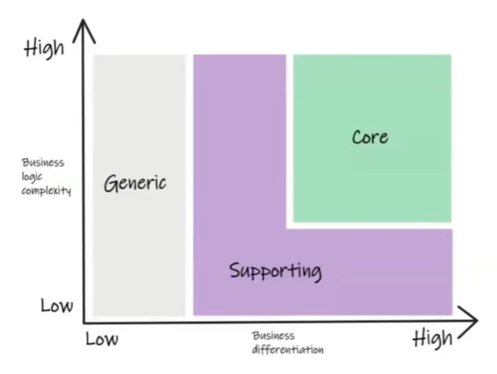
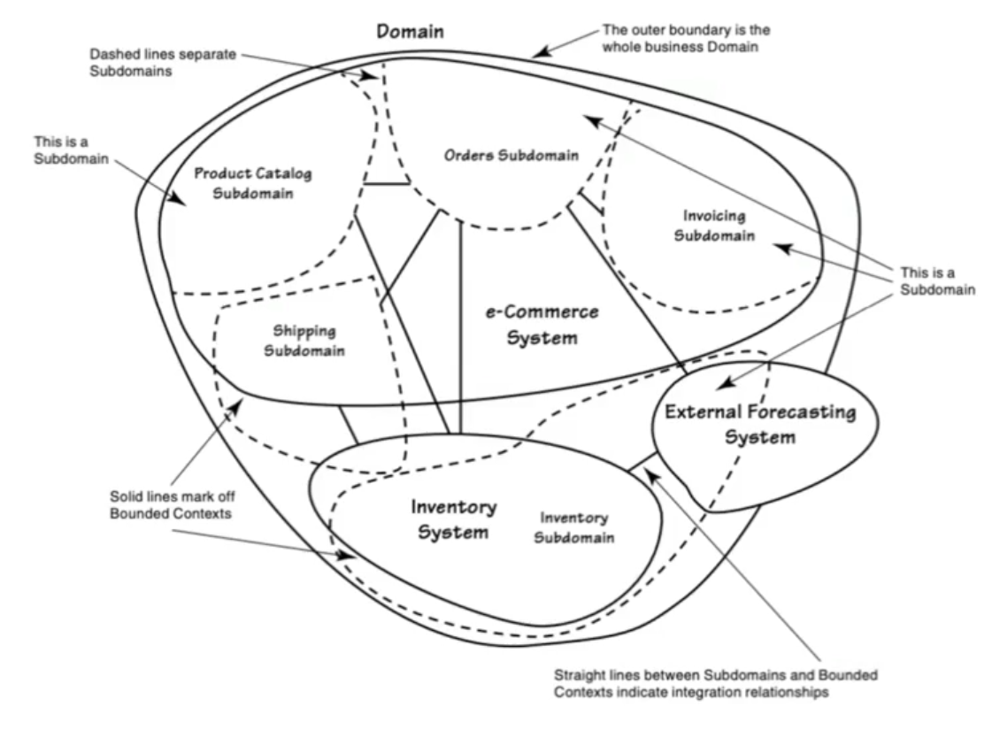
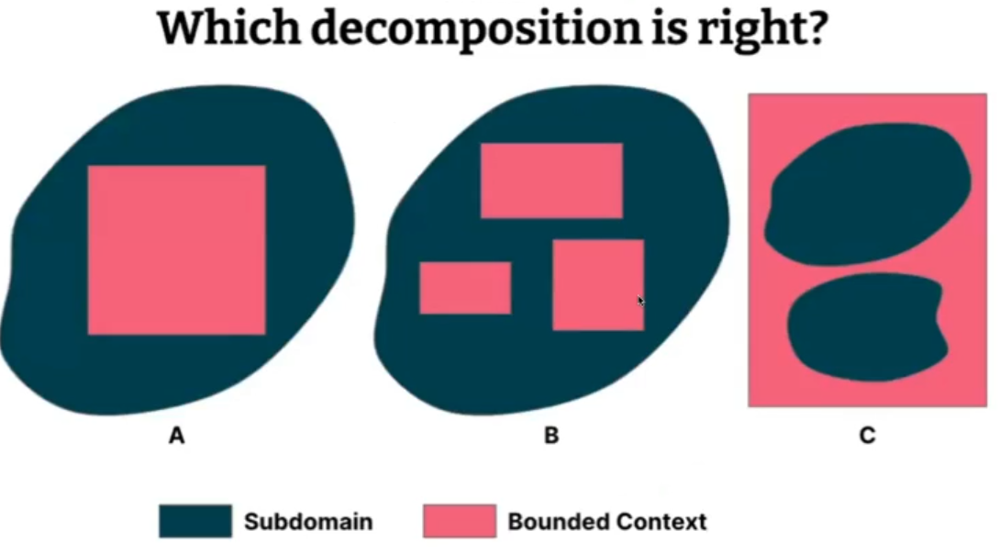
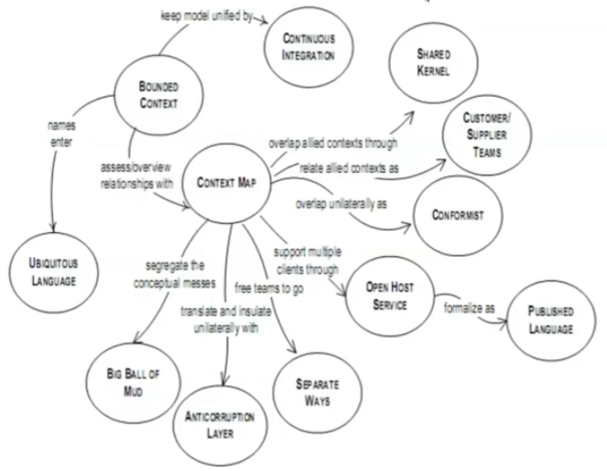
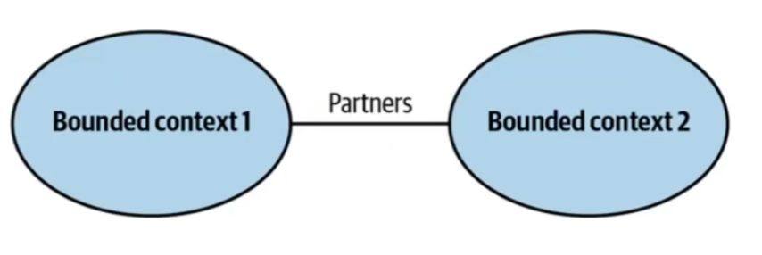
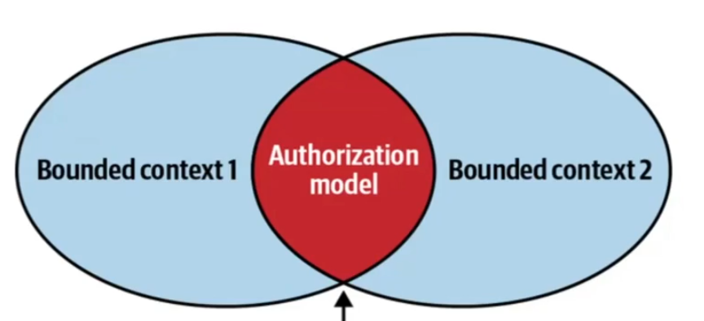
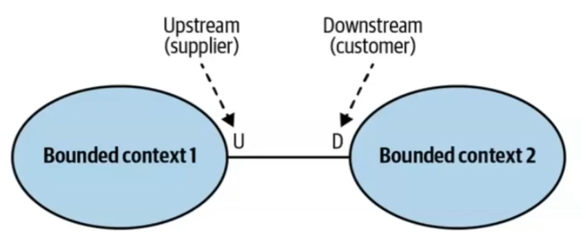
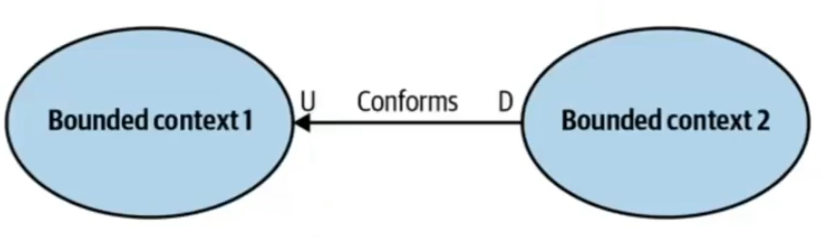
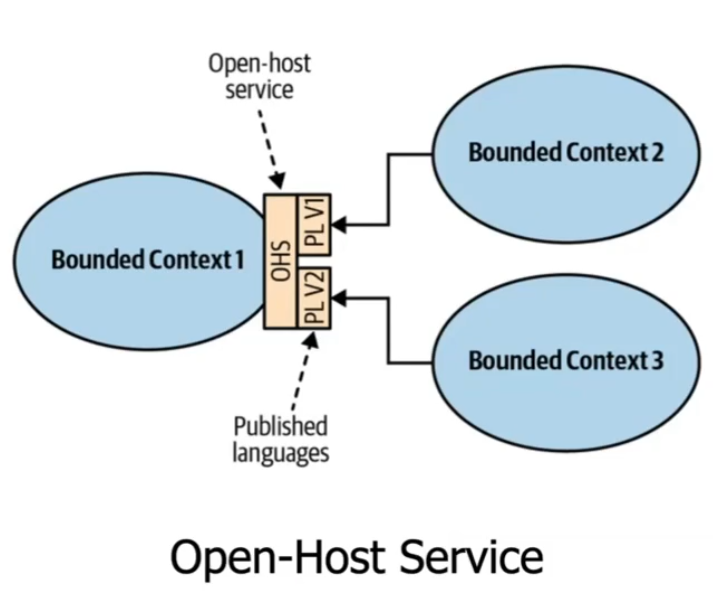
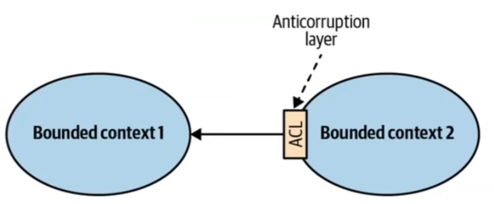

# Introdução
`Domínio é o problema, em termos de negócio`, que precisa ser resolvido <u>independente da tecnologia que será utilizada</u>.

Todo domínio pode e deve ser `dividido em ários subdomínios`.

# Tipos de subdomínios

- `Core ou Basic`: É o mais importante e que traz mais valor para a empresa, é onde você coloca seus maiores e melhores esforços.
- `Support ou auxiliary`: Complementa o core domain, sem eles talvez seja difícil ter sucesso no negócio, mas você não precisa aplicar seus melhores esforços nele.
- `Generic`: É um subdomínio que pode ser delegado para outra empresa ou mesmo ser um produto de mercado.

> O melhor software é aquele que você `não precisa desenvolver`.

# Bounded Context

Um `Bouded Context`é um limite explícito onde <u>um ou mais subdomínio são implementados</u> .
> Alguns `Bounded Context` podem ter mais de um subdomínio. Não é exatamente uma relação `um para um`.

## Relações entre Bounded Contexts

# Subdomains
- `Ride`: Ciclo de vida das corridas, desde a solicitação da corrida até o término, incluindo o cálculo da tarifa.
- `Account`: Cadastro de contas de usuário (passageiros e motoristas).
- `Navigation`: Controle da posição geográfica de cada corrida.
- `Payment`: Processamento de pagamentos
- `Communication`: Envio de email e SMS

> A integração entre bounded countexts se dá por meio de integração

---

`Bounded Context`: Problema que a organização resolve
`Subdomain`: São as áreas de conhecimento que compõem o o problema que a organização resolve.

---
# Integração
> Geralmente acontece entre diferentes bounded contexts por meio de APIs, eventos ou mensagens assíncronas.

Tipos de padrões de integração numa perspectiva de DDD:

## Parceria (Partnership)
Aqui os bounded contexts colaboram de forma próxima, compartilhando informações e responsabilidades para alcançar objetivos comuns.

> Geralmente gateways de pagamento, integração com serviços externos não se caracteriszam como parcerias, pois o cliente sente tem que se adequar ao fornecedor.

Mesmo neste padrão existem tipos de parcerias, ou de implementação de parcerias:

### Shared Kernel

Aqui a parceria entre dois bounded context acontece por meio de código compartilhado. Isso pode acontecer de diversas maneiras:
- Bibliotecas compartilhadas
- Módulos comuns
- Componentes reutilizáveis
- Pacotes compartilhados
- Monorepo

> [IMPORTANTE] Tenha documentação , utilize versionamento e tome cuidado com as `breaking changes`.

Um detalhe importante nesta abordagem: é que a dependência entre todos os bounded contexts relacionados dessa forma é a nível de código. E qualquer alteração em um deles pode impactar os demais, exigindo coordenação e cuidado na gestão das mudanças.

### Supplier/Customer (Fornecedor/Cliente)

Aqui vamos ter dois papeis no relacionamento. Um vai ser o upstream (o supplier, fornecedor) e o outro será o downstream (o customer, cliente).

> [IMPORTANTE] É sempre importante que exista teste de contrato <u> para garantir o funcionamento da API</u>.

## Conformist (Conformista)

Não é exatamente uma relação de parceria. A ideia aqui é o cliente ou downstream se conformar com as decisões do fornecedor ou upstream, sem tentar impor mudanças.

### Open Host

Aqui o fornecedor ou upstream disponibiliza uma API ou serviço que outros bounded contexts podem consumir. O foco é fornecer uma interface estável e confiável para que os clientes possam se integrar sem depender de detalhes internos do fornecedor.

Normalmente o fornecedor encapusula um determinado nível de complexidade e expoe apenas a interface necessária para os consumidores, geralmente mais simples e estável.

> [IMPORTANTE] O fornecedor deve garantir a estabilidade da API e comunicar qualquer mudança de forma clara para os consumidores.

É uma espécie de anti corruption layer, onde o fornecedor protege seus consumidores das mudanças internas, garantindo que a interface pública permaneça estável e confiável.

### Anti-Corruption Layer (Camada de Anti-Corrupção)

Geralmente é uma camada de tradução que serve ao cliente, fica do downstream. Ela traduz as mensagens, comandos ou dados do upstream para um formato compreensível pelo downstream, isolando-o das mudanças e complexidades do fornecedor.

> [IMPORTANTE] A camada de anti-corrupção ajuda a manter a integridade do modelo do cliente, evitando que ele seja corrompido por mudanças ou complexidades do fornecedor.

> `Nem todo bounded context` <u>precise ser desenvolvido, ou ser desenvolvido da mesma forma</u>. 

### Microservices e Bounded Contexts
Bounded contexts são excelentes para delimitar responsabilidades entre microservices, mas não é mandatório. Posso ter vários bounded contexts em uma mesma code base, e compartilhando a mesma base. O importante é garantir que cada bounded context mantenha sua integridade e que as interações entre eles sejam bem definidas e gerenciadas.

Quais são as ventagens e desvantagesn em ter uma arquitetura de `microservices`?

#### Vantagens

- Diversidade tecnológica
- Melhor controler sobre o débito técnico
- Facilidade em acopanhar a evolução tecnológica (por conta de uma base de código menor)

#### Desafios

- Transações distribuídas
- Dificuldade em tratar e diagnosticar erros
- Complexidade técnica mais alta

#### Fazendo uma boa modelagem estratégica

- Divisão da complexidade
- Equipes menores
- Reuso

#### Comunicação assíncrona, Event-Driven Architecture, CQRS

- Escalabilidade
- Independência entre os serviços
- Tolerância à falhas
- Resiliência

 Leva `tempo` até entender qual é a <u>melhor forma de dividir os bounded contexts</u>.

 ## Liskov Substitution

 `Se S é subclasse de T` então objetos do tipo T pode ser substituídos por objetivos do tipo S <u> sem quebrar o funcionamento do programa</u>.

 Apenas definir uma subclasse `não implica manter a coerência e preservar a invariância`.

 > Invariância é o princípio de que as propriedades e comportamentos de uma classe devem permanecer consistentes e válidos mesmo quando a classe é estendida por subclasses. é o estado interno da classe.

 Maneiras de quebrar este pincípio que muitas vezes passam despercebidas incluem:
 - Alterar o comportamento esperado de métodos herdados
 - Modificar o estado interno de forma inconsistente
 - Violar as pré-condições ou pós-condições definidas na classe base

 `pré condições` são as condições que devem ser verdadeiras antes da execução de um método, enquanto `pós condições` são as condições que devem ser verdadeiras após a execução do método. Quebrar essas condições pode levar a comportamentos inesperados e violar o princípio de substituição de Liskov.

As pré-condições não podem ser fortalecidas, ou mais restritiva com relação a super classe.
As pós-condições não podem ser enfraquecidas, ou menos restritiva com relação a super classe.
O estado interno, nvariância, deve ser preservado e não pode ser alterado de forma inconsistente em subclasses.

> O princípio é sobre cumprir as espectativas definidas pela superclasse, garantindo que as subclasses possam ser usadas de forma intercambiável sem introduzir comportamentos inesperados.

> A proposta da Barbara Liskov foi justamente <u> garantir que as subclasses possam ser intercambiadas sem causar problemas durante a execução do programa</u>.

## Open/Closed Principle (Princípio Aberto/Fechado)

Os `componentes da arquitetura` devem estar <u> abertos para extensão e fechados para modificação</u>.

